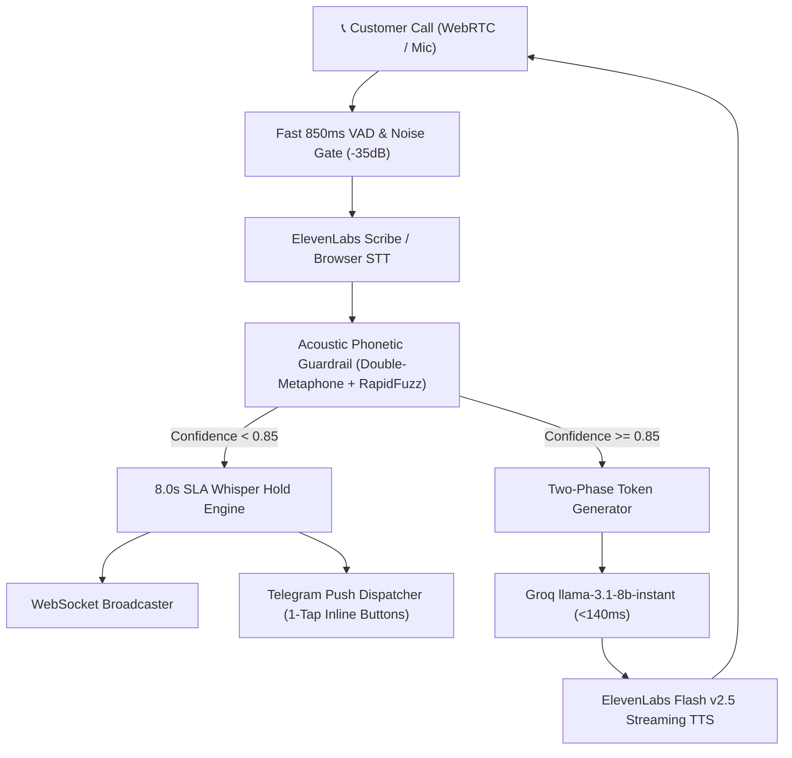

# VOXERA 🎙️⚡
### Industrial-Grade Voice AI Architecture & Deterministic Human Co-Pilot Runtime

VOXERA is an enterprise Voice AI platform engineered for high-concurrency, accent-diverse, noisy physical environments (cafes, dental clinics, real estate brokerages, customer support desks). It bridges conversational LLMs with deterministic transactional consistency, sub-700ms voice turn latency, and an interactive Human-in-the-Loop Co-Pilot.

---

## 🌟 Key Highlights

- **⚡ Sub-700ms Turn Latency:** Fast VAD silence endpointing (850ms) paired with `llama-3.1-8b-instant` (<140ms LLM turn) and ElevenLabs Flash v2.5 sentence streaming.
- **🛡️ Acoustic & Phonetic Guardrail:** Composite scoring ($0.60 \times S_{\text{lex}} + 0.40 \times S_{\text{phon}}$) utilizing Double-Metaphone and RapidFuzz to resolve garbled Indian Hinglish pronunciations (*"do hezalnat cold brew"* -> *Hazelnut Cold Brew*).
- **🔒 Two-Phase Verification Lock:** Hardened against hallucinations and prompt injection. Financial orders cannot be committed without a dynamic schema verification token and explicit customer read-back.
- **🤝 Industrial Human Co-Pilot & SLA Whisper:** Real-time 8.0s countdown SLA. If audio confidence is low (<0.85) or an owner transfer is requested, audio holds dispatch interactive notifications to the owner's phone via Telegram with 1-tap call takeover and whisper actions.
- **⚔️ Multi-Turn AI Combat Arena:** 5 pre-deploy adversarial gauntlet scenarios testing social engineering, mid-call order modifications, off-catalog traps, and manager escalations with automated self-healing prompt patching.

---

## 🏗️ System Architecture



---

## 🚀 Quick Start

### Prerequisites
- Python 3.11+
- Node.js 18+
- Groq API Key
- ElevenLabs API Key

### Backend Setup
```bash
cd backend
python -m venv venv
# Windows:
.\venv\Scripts\activate
# Linux/Mac:
source venv/bin/activate

pip install -r requirements.txt
cp .env.example .env
# Fill in your GROQ_API_KEY, ELEVENLABS_API_KEY, etc.

uvicorn backend.main:app --host 0.0.0.0 --port 8000 --reload
```

### Frontend Setup
```bash
cd frontend
npm install
npm run dev
```
Open [http://localhost:3000](http://localhost:3000) to access the Voice Agent Studio and Developer Inspector.

---

## 🧪 Self-Breaking Torture Suite
Run the 5-point resilience benchmark verifying latency, noise rejection, multi-turn arena, Telegram escalation, and dynamic entity compiler:
```bash
python backend/test_system_torture.py
```
